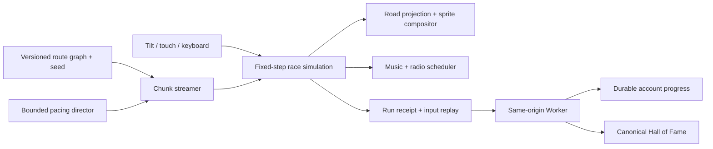

# Proposed runtime boundaries

Status: design proposal. Only the Flutter shell and empty Flame game exist.

The simulation owns road-relative position, velocity, car handling, collisions,
traffic intentions, gate state and elapsed time. The renderer projects those
facts; it must not determine collision outcomes from sprite overlap. Separate
random streams control mechanics and decoration. A versioned seed plus input
stream supports reproducing runs, but determinism must be tested across target
platforms before choosing replay verification as the ranking authority.

Chunks carry lane connectivity, curvature/elevation, biome sockets, warning
windows, hazards, exits, checkpoints, audio cues and unlock triggers. Validate
reachable paths and passable lanes before activation. Prefetch candidate branches
and their assets before a fork; hold enough prior content for safe recovery.

The director operates within authored difficulty envelopes. It schedules build-up,
peaks and recovery; it cannot bypass warning distances or create impossible
closures. Competitive rules must settle whether adaptation is disabled, seeded,
or otherwise accounted for before the global board is enabled.

Flutter owns menus and accessible overlays. The wheel rim belongs above the game
view; utility buttons must remain reachable above its gesture surface. Sensor,
pointer and keyboard adapters normalize to the same steering/braking intent.
Profile actions during a run require a deliberate pause policy.

Region transitions are streaming boundaries, not blocking loading screens.
Audio, TTS, identity and cloud requests may never stall the simulation. Browser
backgrounding, portrait rotation and explicit pause need clock/eligibility policy.

Next proof: one hill/curve, a single fork, a bridge occlusion, a lane closure,
a traffic merge, a timed gate and safe crash recovery. Only then fix asset budgets
and commission final production sprite sheets.
